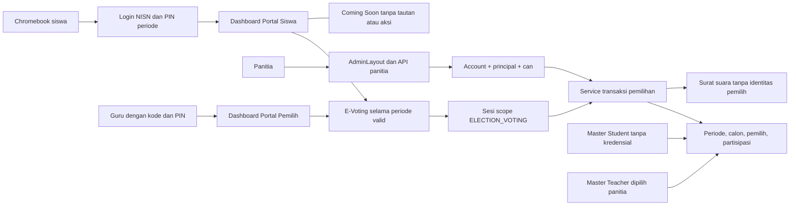

# Desain teknis

Status: rincian teknis proposed; autentikasi [ADR 0002](adr/0002-autentikasi-portal-siswa-mvp.md) dan keputusan operasional pada [README](README.md) sudah disepakati. Batas request perlu dikalibrasi saat gladi bersih; timeout sesi sudah tetap.

Pembaruan implementasi 16 Oktober: [pemilih guru](09-usulan-pemilih-guru.md) disetujui dan diterapkan. Guru dipilih eksplisit dari Teacher master sebelum buka, memiliki kode guru + PIN periode, dan masuk `/pemilih`. Setiap guru mendapat empat hak suara dengan bobot sama; hasil digabung tanpa breakdown siswa/guru. Semua hitungan roster, kesiapan, PIN, partisipasi, rekonsiliasi dan tutup lebih awal memakai gabungan maksimal 99 pemilih. Sesi guru tidak membuka `/siswa`, sesi siswa tidak membuka `/pemilih`, dan cookie voting tidak memenuhi akses internal. Tidak ada penambahan guru pada periode yang sudah dibuka.

## Bentuk integrasi

Seluruh halaman/API pemilu dirender on-demand. Pertahankan `output: static`, beri `prerender = false` pada setiap route baru. Gunakan service kecil di `src/lib/voting/`, dipanggil baik oleh form Astro maupun endpoint; route hanya mengurus HTTP, autentikasi, validasi bentuk input, dan respons. Invariant domain, otorisasi tindakan, serta transaksi tetap diperiksa di service. Tidak ada polling kandidat terpilih, offline ballot queue, atau penyimpanan pilihan di browser.

Portal Siswa bukan realm autentikasi umum: `/siswa` hanya shell dashboard untuk sesi dengan scope `ELECTION_VOTING`. Login berhasil untuk pemilih belum lengkap selalu kembali ke dashboard, bukan langsung ke ballot maupun `returnTo` bebas. Kartu E-Voting membuka layanan periode yang sama; kartu masa depan hanya teks Coming Soon tanpa href, tombol, event handler, tabindex aksi, fetch data personal atau API layanan. Tidak ada registrasi mandiri, password permanen, lupa/reset password siswa, maupun endpoint ubah PIN siswa. Akun permanen/layanan personal/akademik tetap di luar MVP.

Guard terpusat memakai allowlist dashboard/sesi/status/vote dan kecocokan periode/scope pada setiap request. Keberadaan cookie atau `studentId` di locals tidak berarti siswa login untuk seluruh portal. Namespace layanan masa depan ditolak secara default (404 ketika route belum ada; guard 403 untuk scope pemilu bila route diperkenalkan kemudian). Jangan membuat endpoint akademik dummy. Dashboard, halaman ballot, status dan activity hanya tersedia selama periode valid; revalidasi saat deep link, reload dan pageshow. Halaman login netral, logout, layar selesai dan hasil publik terpisah tetap dapat dibuka di luar jadwal tanpa memberi akses personal.

## Lifecycle dan waktu

State tersimpan hanya `DRAFT → SCHEDULED → CLOSED → ARCHIVED`. Publikasi adalah `publishedAt`, bukan state pengganti penutupan. State tampilan dihitung dengan waktu database:

| State tersimpan/kondisi | Tampilan | Tindakan |
| --- | --- | --- |
| DRAFT, termasuk tanggal awal lewat | Persiapan | Edit jadwal, calon dan roster; buat PIN; belum bisa memilih. Perbaiki jadwal ke masa depan sebelum menjadwalkan |
| SCHEDULED, now < opensAt | Terjadwal | Roster/calon dapat dilengkapi atau dikoreksi setelah pengesahan registrar; distribusi/reissue PIN boleh |
| SCHEDULED, opensAt ≤ now < closesAt | Dibuka | Login dan kirim suara; pantau partisipasi saja |
| SCHEDULED, now ≥ closesAt | Menunggu penutupan resmi | Suara baru ditolak; panitia rekonsiliasi dan menutup; hasil tetap tersembunyi |
| CLOSED | Ditutup resmi | Hasil tersedia bagi pemegang `evoting.hasil`; publikasi terpisah |
| ARCHIVED | Arsip | Read-only; hasil publik hanya bila pernah dipublikasikan |

`opensAt`/`closesAt` disimpan `timestamptz`; UI menggunakan `Asia/Jakarta` (WIB). Input admin wajib offset ISO 8601 atau dikonversi secara eksplisit dari WIB, tidak bergantung timezone browser/server. Waktu browser hanya untuk countdown; predicate server memakai `clock_timestamp()` **setelah menunggu lock**, bukan timestamp awal transaksi. Tidak perlu cron untuk membuka atau menghentikan penerimaan suara.

Periode dijadwalkan hanya bila tepat empat organisasi, tiap organisasi memiliki minimal satu pasangan valid, roster resmi nonkosong, tepat empat hak pilih per pemilih dan semua PIN awal diterbitkan. Roster/calon dapat disunting sampai waktu buka, lalu membership roster dan slate calon dibekukan. Jadwal dapat diperpanjang satu kali maksimal 60 menit oleh ketua/pengelola pemilu yang bukan pengelola PIN; alasan, aktor dan waktu dicatat di audit/berita acara. Close resmi tidak dapat dibatalkan atau dibuka kembali. Jika gangguan bertahan setelah perpanjangan, hentikan pada tenggat dan dokumentasikan; sekolah memutuskan tindak lanjut. Pemilihan ulang memakai periode baru dengan seluruh pemilih, tanpa suara kertas campuran atau transfer ballot lama. Koreksi NISN pemilih yang belum memberi suara adalah pengecualian terkontrol setelah buka: dua pemeriksa, Student ID tetap, PIN lama/sesi dicabut dan PIN baru diterbitkan. Jangan mengubah NISN setelah voter itu memberi suara.

## Akun panitia dan RBAC

Reuse `getPrincipal()` dan `can()`; jangan membuat role panitia baru. Superadmin memperoleh izin melalui wildcard yang ada; staf/guru/siswa **tidak mendapat izin pemilu otomatis**. Berikan override kepada individu lewat `/admin/pengguna/[id]`. Revoke harus langsung berlaku pada request berikutnya. Pengubahan grant/role yang terkait panitia perlu audit dan CSRF pada jalur akun yang sudah ada.

| Kapabilitas baru | Batas |
| --- | --- |
| `evoting.lihat` | Masuk area pemilu dan melihat konfigurasi tanpa PII/hasil |
| `evoting.kelola` | Buat/edit DRAFT, calon, schedule, archive |
| `evoting.pemilih` | Lihat/sinkronkan/koreksi daftar siswa sebelum periode dibuka |
| `evoting.pin` | Terbitkan/reset PIN, wajib autentikasi ulang admin |
| `evoting.partisipasi` | Jumlah total dan empat organisasi; status siswa individual hanya jika juga memiliki `evoting.pemilih` |
| `evoting.tutup` | Penutupan resmi setelah deadline atau seluruh pemilih selesai empat suara; autentikasi ulang dan prosedur saksi |
| `evoting.perpanjang` | Perpanjangan satu kali maksimal 60 menit oleh ketua pemilu yang ditunjuk; pemisahan dari pengelola PIN dijaga secara operasional |
| `evoting.hasil` | Membaca agregat setelah CLOSED/ARCHIVED; tidak bisa melewati gate state |
| `evoting.publikasi` | Publikasi setelah CLOSED; autentikasi ulang |

Semua aksi membutuhkan `evoting.lihat` ditambah kapabilitas tindakan. Nav memakai syarat yang sama. API `/api/admin/e-voting/**` tidak otomatis dilindungi oleh `API_CAP` sekarang: tambahkan guard prefix dengan batas segmen yang tepat, lalu guard tindakan pada handler/service. `/admin/e-voting` masuk `ROUTE_CAP`. Realm siswa tidak membaca cookie admin/alumni; admin tidak menerima cookie siswa.

Master persisten memakai kapabilitas terpisah `student.kelola` pada `/admin/siswa` dan `/api/admin/students/**`, tanpa keharusan periode aktif. Tidak diberikan otomatis ke role siswa/staf/guru. Mutasi master diaudit dengan `periodId = null`, tanpa dump NISN/nama. Sinkronisasi roster hanya membaca master dan memerlukan `evoting.pemilih`; PIN/sesi pemilu tidak pernah memenuhi `student.kelola`.

## Pasangan calon berbasis Student

Setiap posisi calon menunjuk `Student.id` yang sudah ada. Admin memilih ketua dan, bila ada, wakil dari master; tidak ada input nama/kelas calon bebas. `CandidateMember` menyimpan posisi `CHAIR` atau `VICE_CHAIR`, `studentId`, serta snapshot nama dan kelas pada saat pendaftaran calon. Foto opsional melekat pada anggota; bila digunakan, reuse media sekolah yang sudah tersedia dan jangan memberi izin media hanya karena panitia mengelola pemilu.

Satu `CandidatePair` memuat tepat satu CHAIR dan nol atau satu VICE_CHAIR dari Student berbeda. Calon tanpa wakil sah. Simpan perubahan anggota secara atomik. Aturan uniqueness `(periodId, organization, studentId)` mencegah seorang siswa ditugaskan di pasangan lain untuk organisasi yang sama pada periode itu; ia masih dapat menjadi calon pada organisasi lain. Jumlah pasangan per organisasi dinamis, dengan minimal satu calon valid (ketua wajib, wakil opsional) untuk membuka periode. Backend memvalidasi ID master ada dan valid, FK menolak Student yang tidak ada, dan deferred constraint/service memeriksa komposisi calon ketika perubahan kandidat commit dan saat periode dibuka.

Snapshot anggota tidak ikut berubah ketika master Student dikoreksi. Hasil, arsip dan query riwayat calon menampilkan snapshot historis; indeks `CandidateMember.studentId` memungkinkan riwayat kepesertaan calon dicari untuk fitur Portal Siswa kelak. Riwayat jabatan/masa kerja pemegang jabatan dan pengelolaan organisasi tetap di luar MVP. Seluruh create/edit/delete pasangan, penetapan studentId, perubahan ballot number, visi/misi dan foto ditulis sebagai audit dalam transaksi yang sama. Lock periode dan predicate `now < opensAt` menutup race dengan waktu buka; setelah dibuka perubahan slate ditolak.

## Master siswa, pendaftaran oleh admin, PIN dan pencetakan

Simpan master `Student` persisten dengan ID stabil, NISN string 10 digit unik global, nama dan kelas terkini; tanpa PIN/password/session/account role. `ElectionVoter` mereferensikan Student dan menyimpan snapshot NISN/nama/kelas serta kredensial per periode. Student dapat ada tanpa keikutsertaan pemilu; satu Student hanya satu ElectionVoter per periode. Keberadaan master bukan bukti eligibility atau autentikasi. Master tidak dihapus ketika periode ditutup, PIN dicabut, sesi berakhir atau data kredensial dibersihkan.

Calon pemilih siswa bersumber dari Student yang terhubung ke `SchoolClass` dengan `academicYear` sama persis dengan periode. Panitia memilih subset melalui ID siswa, dengan pencarian/filter kelas, checkbox dan pratinjau; seluruh siswa hanya ikut bila dipilih eksplisit. Tidak ada impor kedua atau pembuatan Student. Penambahan mempertahankan snapshot/roster existing dan membuat empat eligibility atomik untuk siswa terpilih yang belum ada. Guru dipilih dari tabel Teacher terpisah. Kedua mutasi mengunci periode yang sama, menolak total gabungan di atas 99, dan membuat audit bersama roster/empat eligibility. Student tanpa kelas terhubung dikecualikan. Rincian [pilihan siswa dan DRAFT](10-daftar-pemilih-dan-draft.md).

Koreksi NISN dilakukan pengelola data dari sumber resmi dengan dua pemeriksa; Student ID tetap dan tidak ada pencocokan otomatis berdasarkan nama. Hingga periode dibuka, sinkronkan snapshot secara eksplisit; perubahan NISN mengosongkan hash/fingerprint, menaikkan versi, mencabut sesi dan memerlukan PIN baru. Setelah dibuka, membership roster dan slate calon beku. Koreksi NISN untuk voter yang belum memberi suara tetap diperbolehkan lewat pengecualian terkontrol: sumber resmi, dua pemeriksa, Student ID sama, revokasi PIN/sesi dan penerbitan PIN baru. NISN voter yang sudah memberi suara tidak boleh diubah. Perubahan master tidak mengubah snapshot periode lama. Penghapusan roster sebelum buka tidak menghapus Student; hard-delete master yang direferensikan pemilu ditolak.

PIN dibuat dengan `crypto.randomInt(0, 10 ** 10)`, dipad kiri nol menjadi 10 digit; bukan NISN/tanggal lahir/`Math.random`. Material bcrypt cost 12 adalah HMAC-SHA256 atas `pin-hash`, periodId, identifier dan PIN dipisahkan NUL; identifier siswa tetap NISN, identifier guru adalah kode guru. Format hash siswa lama tidak diubah. Pepper terpisah dari `JWT_SECRET`, tersimpan di secret manager dan backup konfigurasi; rotasi pepper memerlukan penerbitan ulang PIN. Benchmark cost pada runtime sebenarnya; jangan mengurangi proteksi diam-diam karena lambat.

Keunikan PIN berlaku di dalam periode: simpan `pinFingerprint = HMAC-SHA256(VOTING_PIN_SECRET, "unique-pin" + separator + periodId + separator + pin)` dengan domain berbeda dari input bcrypt. Unique constraint `(periodId, pinFingerprint)` menolak benturan, termasuk penerbitan paralel; buat ulang nilai bentrok dan ulangi transaksi dengan batas retry, jangan mencetak sebelum commit. Fingerprint tidak berisi NISN agar benar-benar mendeteksi PIN sama antar pemilih; tetap rahasia, tidak diekspos/log. Jangan memakai SHA-256 PIN tanpa secret. Penerbitan ulang harus memilih nilai berbeda dari PIN yang sedang berlaku. PIN periode lain tidak dipakai sebagai fallback autentikasi.

Alur cetak:

1. Panitia dengan izin PIN mengirim POST dengan CSRF, password admin saat ini, daftar pemilih (maksimal 25) dan versi kredensial yang dilihat. Initial issue hanya jika hash masih null; reset secara eksplisit memerlukan alasan kode yang terkontrol.
2. Buat PIN/hash/fingerprint sebelum transaksi. Initial issue hanya sebelum `opensAt`; reset dapat dilakukan sampai `closesAt` untuk pemilih yang belum lengkap. Lock periode lalu voter dengan urutan ID konsisten; revalidasi state/versi/keunikan PIN, simpan hash dan fingerprint, naikkan `pinVersion`, hapus sesi siswa dan tulis audit tanpa PIN. Jika satu baris stale, rollback batch seluruhnya.
3. Sesudah commit, respons HTML print-only berisi slip per siswa (periode, nama, kelas, NISN snapshot, PIN, `/siswa/masuk?periode=<slug>`, jadwal WIB dan petunjuk masuk dashboard Portal Siswa). Jelaskan PIN hanya untuk pemilu periode ini, bukan layanan akademik. Tidak ada NISN/PIN dalam URL. Tidak redirect ke URL yang dapat membaca PIN lagi. `no-store`, tanpa analytics, tanpa auto-print pada GET.
4. PIN mentah hanya berada dalam memori request dan dokumen cetak. Tutup halaman setelah cetak; matikan header/footer browser pada cetakan. Printer panitia terkendali, hapus spool sesuai kemampuan perangkat, simpan kertas tertutup dan bagikan individual. Tidak ada unduh PDF massal di penyimpanan publik.
5. Respons hilang/print gagal: PIN lama tidak dapat dibaca ulang. Reset batch terdampak dengan versi terkini; kertas lama dinyatakan tidak berlaku. Form resubmit lama harus mendapat konflik versi, bukan merotasi diam-diam.

PIN berlaku untuk melanjutkan sampai deadline; bukan token sekali login. Reset setelah sebagian memilih mempertahankan seluruh status partisipasi dan ballot. Reset setelah siswa selesai atau periode berakhir ditolak. Penonaktifan darurat kredensial mencabut sesi tetapi tidak menghapus roster/denominator atau suara; wajib alasan dan audit. Issue/reset/enable/disable memerlukan `evoting.pin` dan `evoting.pemilih` selain izin masuk area; panitia perlu memahami bahwa penonaktifan tidak membatalkan suara yang telanjur masuk.

## Login dan sesi Chromebook

Istilah reset PIN dalam dokumen ini berarti penerbitan ulang **oleh admin berizin**; tidak ada tautan lupa password, flow password reset atau pembuatan password untuk siswa. Akun internal panitia tetap dapat memakai password existing.

- Form `/siswa/masuk` memakai NISN + PIN + periode dari slug publik yang di-resolve server. Jika slug tidak diberikan, server menawarkan periode yang sedang dibuka; tidak menebak periode dari PIN. Gagal karena NISN tidak ada dalam roster, PIN salah, atau kredensial nonaktif menghasilkan pesan sama dan dummy bcrypt dengan cost sama. Master Student tanpa roster/PIN tidak dapat login. Jangan kembalikan identitas siswa sebelum berhasil.
- Sesi berupa token acak 32 byte, hanya hash SHA-256 disimpan. Cookie produksi `__Host-smkdh_vote`, `Secure`, `HttpOnly`, `SameSite=Strict`, `Path=/`, tanpa Domain dan tanpa persistent Max-Age. Local HTTP memakai nama khusus dev; produksi wajib HTTPS.
- Satu sesi aktif per voter, tersimpan dengan scope enum `ELECTION_VOTING` dan periode yang diturunkan dari voter. Tidak ada cookie sesi portal permanen atau pertukaran token pemilu menjadi token umum. Login baru, reset, penonaktifan, logout, atau penyelesaian empat suara mencabut sesi sebelumnya. Setelah bcrypt di luar transaksi, lock voter dan cek ulang `pinVersion`/hash/aktif serta jendela waktu untuk menutup race dengan reset/deadline.
- Pelaksanaan sekolah menyediakan tiga Chromebook bersama. Maksimal tiga sesi pemilih aktif bersamaan, masing-masing satu akun pada satu perangkat; siswa bergantian memakai Chromebook. Uji sesi tiga pemilih siswa/guru yang aktif bersamaan dan pembersihan sesi/tab saat pergantian siswa. Perangkat pribadi dan login serentak seluruh pemilih bukan mode MVP.
- Idle 5 menit, absolute 15 menit atau deadline (mana lebih cepat); server memeriksa keduanya. `lastSeenAt` hanya diperpanjang oleh interaksi eksplisit, bukan background polling. Peringatan sebelum idle habis dan tombol lanjut yang dapat diakses; absolute limit tidak diperpanjang.
- Kelanjutan berasal dari empat boolean partisipasi di DB. UI hanya menampilkan “sudah memilih”; tidak menyimpan atau menampilkan kembali nama kandidat pilihan. Login ulang parsial dengan PIN valid yang sama menuju dashboard `/siswa`, kemudian tombol lanjut ke organisasi belum selesai. Jika semua selesai saat login ulang selama periode valid, arahkan ke `/siswa/selesai`, kosongkan cookie tanpa sesi aktif baru. Di luar periode valid, jangan memverifikasi PIN untuk membuka riwayat pribadi; tampilkan status periode netral.
- POST logout membatalkan sesi di DB dan menghapus cookie dengan atribut sama. Tombol logout ada di dashboard maupun pemungutan. Pada sukses suara keempat, sesi dicabut dalam transaksi dan UI membersihkan identitas/pilihan, lalu menampilkan layar `/siswa/selesai` generik dengan tombol “Siswa berikutnya” menuju login. Tidak kembali ke dashboard bersesi. Back atau tab lama harus ditolak/revalidasi, termasuk pada dashboard.
- Semua HTML/JSON/print sukses maupun error menggunakan `Cache-Control: private, no-store`, `Referrer-Policy: no-referrer`, noindex, dan larangan framing. Tidak ada localStorage, sessionStorage, IndexedDB atau service worker untuk identitas/pilihan. Refresh/back/bfcache/pageshow harus membersihkan pilihan dan revalidasi status sebelum memungkinkan kirim; jangan percaya DOM lama.
- Timer klien mengosongkan tampilan saat idle, bahkan offline, tetapi server expiry tetap otoritas. Chromebook terkelola memakai guest/kiosk, password saving dimatikan, dan panitia memeriksa layar netral sebelum pergantian pengguna. `autocomplete=off` saja tidak menjamin browser tidak menyimpan kredensial.

Server-side expiry dan cookie flag mengikuti prinsip [OWASP Session Management](https://cheatsheetseries.owasp.org/cheatsheets/Session_Management_Cheat_Sheet.html). Timeout dan satu sesi aktif adalah keputusan lokal, bukan angka baku OWASP.

## Transaksi pengiriman suara

Input hanya organisasi dan candidate ID; voter/period berasal dari sesi dan route yang dicocokkan. Gunakan interactive `$transaction` Prisma 7, seluruh query melalui `tx`, SQL berparameter untuk row lock. Detail API Prisma 7 merujuk [referensi lokal transaksi](../../.agents/skills/prisma-client-api/references/transactions.md); dokumentasi web Prisma yang dibuka saat audit sudah mengarah ke ORM 8, sehingga API versi baru tidak diadopsi.

Urutan setiap submit, pada isolation `ReadCommitted` dengan locking eksplisit:

1. Verifikasi HTTP/CSRF, ukuran/bentuk input dan token sesi; kemudian masuk transaksi singkat. Batas awal `maxWait` 2 detik, `timeout` 5 detik dan lock timeout DB lebih pendek dari timeout request, dikalibrasi lewat tes Neon.
2. Lock baris periode `FOR SHARE`. Lock voter `FOR UPDATE`; lalu baca ulang sesi aktif dari DB dan cek idle/absolute expiry, credential enabled, serta period cocok. Semua login/reset/logout yang menyentuh voter mengikuti urutan periode → voter → session.
3. Ambil waktu DB setelah lock. Jika state bukan SCHEDULED atau tidak memenuhi `opensAt <= now < closesAt`, tolak. Validasi candidate milik periode dan organisasi yang sama. Slate calon telah dibekukan pada waktu buka.
4. Jalankan update bersyarat pada partisipasi `(voterId, organization)` dengan `hasVoted = false → true`; jumlah affected harus tepat satu. Jika sudah true, tolak `ALREADY_VOTED`. Tidak pernah membandingkan kandidat dengan ballot lama karena tidak ada tautan.
5. Insert satu `Ballot` dengan UUIDv4, period, organization, candidateId saja. Insert gagal harus throw dan me-rollback update partisipasi; jangan catch lalu return sukses di dalam transaksi.
6. Baca empat status. Jika lengkap, hapus sesi; jika belum, perbarui aktivitas sesi. Commit, baru kirim hasil tanpa ballot ID/candidate choice. Jangan menulis audit per suara yang mengaitkan siswa dengan waktu/calon.

Lock bersama pada periode mengizinkan banyak siswa serentak, tetapi berbenturan dengan lock penutupan `FOR UPDATE`; semantik ini dijelaskan [PostgreSQL explicit locking](https://www.postgresql.org/docs/current/explicit-locking.html). Tidak memperbarui baris periode pada setiap vote karena itu akan menserialisasi semua siswa.

Waktu penerimaan adalah pemeriksaan setelah lock: request yang antre sampai deadline ditolak; transaksi yang lolos sesaat sebelum deadline dapat commit sesudahnya dan tetap sah. Penutupan menunggu transaksi tersebut selesai. Tetapkan arti ini dalam berita acara, jangan mengklaim semua commit selalu terjadi sebelum `closesAt`.

Retry maksimal dua kali hanya untuk konflik/deadlock yang diketahui telah rollback, dengan jitter dan pengecekan seluruh predicate ulang. Error mapping adapter Neon harus dibuktikan lewat tes. Timeout jaringan/hasil commit tidak diketahui tidak boleh dianggap rollback: klien mengambil `/status` atau login ulang. Jika organisasi sudah terisi, jangan kirim lagi; jika belum, siswa mengonfirmasi ulang. Duplikasi tidak menghasilkan ballot kedua meskipun kandidat pada retry berbeda. Tidak ada idempotency key yang menghubungkan ballot dan voter.

## Penutupan, partisipasi dan hasil

Dashboard partisipasi menghitung ledger, bukan ballot per kandidat. Ringkasan: total eligible tetap, belum memilih sama sekali, parsial, lengkap, dan jumlah per organisasi. Refresh manual atau interval ≥30 detik; tidak ada feed waktu suara individu atau hasil kandidat tersembunyi di payload/chart/HTML.

Close: reautentikasi admin, lock periode `FOR UPDATE`, cek state dan waktu DB. Penutupan setelah deadline tetap mengizinkan turnout parsial. Penutupan lebih awal memerlukan permintaan eksplisit `early: true`, periode telah dibuka, roster tidak kosong, serta seluruh pemilih terdaftar telah menyelesaikan empat suara. Pemilih dengan PIN nonaktif tetap masuk denominator; tidak ada pengecualian absensi. Cek kelengkapan dilakukan sebelum query tally kandidat, lalu hitung ulang ledger true dan ballot per organisasi, validasi kesetaraan dan batas terhadap roster. Jika belum lengkap, rollback `EARLY_CLOSE_INCOMPLETE`. Jika selisih, rollback dengan kode `RECONCILIATION_FAILED`, hentikan publikasi, investigasi tanpa mengedit ballot. Jika cocok, buat snapshot agregat dengan seluruh kandidat (termasuk nol), total eligible/partisipasi/parsial/lengkap; set CLOSED dan `closedAt`, cabut semua sesi periode, serta tulis audit dalam transaksi yang sama. Lock mencegah vote masuk di tengah snapshot. Jadwal `closesAt` tidak diubah; `closedAt` mencatat waktu penutupan sebenarnya. Audit `PERIOD_CLOSED` mencatat `reasonCode` `ALL_VOTERS_COMPLETED` atau `DEADLINE_REACHED`, jadwal asli, waktu tutup dan total agregat. Penutupan tidak menerbitkan hasil otomatis. Tindakan close berulang pada CLOSED/ARCHIVED mengembalikan status sekarang, bukan membuat snapshot baru.

Endpoint hasil memeriksa CLOSED/ARCHIVED **sebelum** membaca snapshot. Publikasi mengisi `publishedAt`, tanpa mengubah snapshot; publik hanya melihat hasil sesudahnya. Hasil berupa hitungan suara dan persentase per organisasi (denominator = suara organisasi tersebut), tidak menampilkan breakdown kelas, NISN atau daftar siapa memilih siapa. Nama posisi berasal dari snapshot anggota, bukan data Student terkini. Seri tetap seri; tidak menetapkan pemenang lewat sort ID. Periode berikutnya dibuat DRAFT baru dengan ID baru, tidak mereset data periode lama.

## Validasi, CSRF, pembatasan dan audit

Mutasi menerima method/content-type yang didefinisikan, body limit, enum allowlist, string bounded, ID valid, serta ownership/scope di server. Kandidat memakai plain text; foto hanya URL media sekolah yang diizinkan, tidak arbitrary HTML/remote script. Jangan gunakan message exception/SQL mentah sebagai respons.

Wajib exact Origin terhadap konfigurasi origin server; jika Origin tidak ada, validasi origin Referer; null/tidak ada keduanya ditolak untuk mutasi browser ini. Tambahkan token CSRF HMAC bertanda expiry dan realm, terikat token sesi (admin JWT atau student token). Login memakai nonce preauth HttpOnly cookie berumur 5 menit dan token form bertanda tangan yang terikat nonce. Secret `VOTING_CSRF_SECRET` terpisah, verifikasi constant-time. Token sesi tidak boleh terekspos lewat token CSRF. Tidak ada wildcard CORS; tolak cross-site Fetch Metadata. Terapkan pada login/logout, cetak, import, vote, close, publication dan grant panitia. Prinsip origin dan session-bound tokens merujuk [OWASP CSRF Prevention](https://cheatsheetseries.owasp.org/cheatsheets/Cross-Site_Request_Forgery_Prevention_Cheat_Sheet.html).

Limiter PostgreSQL lintas instance: bucket key HMAC dengan `VOTING_RATE_SECRET` atas realm/scope/period/identifier dan window. Increment atomik `INSERT ... ON CONFLICT ... DO UPDATE ... RETURNING` sebelum bcrypt, bukan read-then-write. Usulan: 5 percobaan per NISN/15 menit, 200 percobaan per IP/5 menit; batas IP sekolah harus diuji dengan seluruh Chromebook karena NAT bersama. Endpoint status/activity/vote juga dibatasi per sesi (awal 60 request/menit) agar sesi sah tidak membanjiri DB; endpoint preauth dibatasi per IP. Tambahkan limit global untuk melindungi CPU/hash dan DB; nilai disahkan dari kapasitas. IP hanya dari proxy header tepercaya yang diverifikasi deployment. Bucket berlaku untuk identifier yang tidak terdaftar juga, memberi `429` dan `Retry-After`, tanpa lock akun permanen. Gagal limiter/DB berarti fail closed (`503`), bukan bypass ke memory. Bersihkan bucket kedaluwarsa dengan job terbatas; index expiry wajib. Pisahkan realm admin dari siswa.

Audit admin append-only: actor Account, periode, event allowlist, waktu, target opaque bila perlu, alasan kode, ringkasan perubahan konfigurasi yang diizinkan. Event mencakup create/edit/delete pasangan, perubahan anggota/studentId, ballot number, visi/misi/foto, schedule/open/close/publish/archive, sinkronisasi master roster, issue/reset/disable credential dan perubahan izin. Mutasi roster dan audit commit bersama; jika audit gagal, mutasi gagal. Hindari JSON dump berisi roster/hash atau NISN; audit perubahan calon memakai ID pasangan/anggota dan field yang berubah. Riwayat akun tetap dapat dirujuk ketika akun dinonaktifkan; bila dihapus, actor menjadi null tetapi target/event dan waktu tetap ada.

Log keamanan autentikasi hanya kode outcome dan key pseudonim dengan retensi terbatas; **tidak** NISN, PIN, password, cookie, token, candidate choice, body vote, ballot ID, atau query parameter sensitif. Jangan memasang request replay/APM body capture pada route ini. Error telemetry disanitasi sebelum dikirim. Log aplikasi tidak tamper-proof terhadap DB owner; akses dan salinan audit harus dikelola terpisah sesuai kebutuhan sekolah. Penghilangan data sensitif mengacu [OWASP Logging](https://cheatsheetseries.owasp.org/cheatsheets/Logging_Cheat_Sheet.html).

## Pengecualian data uji ? 15 Oktober 2026

Periode memiliki klasifikasi isTest yang ditentukan saat dibuat dan tidak dapat diedit. Superadmin dapat menghapus satu periode uji yang belum mempublikasikan hasil melalui popup ringkasan, konfirmasi slug, password login, CSRF dan versi preview. Semua turunan periode dibersihkan atomik; master siswa, periode lain dan audit tetap ada. Lifecycle dan proteksi suara periode biasa tetap berlaku. Detail: [pembersihan data uji](08-pembersihan-data-uji.md).
