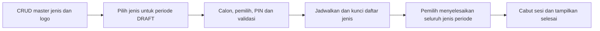

# Usulan jenis pemilihan dinamis dan penyempurnaan hasil

**Pembaruan T11, 18 Oktober:** endpoint hasil internal dan status publikasi401/429 diterapkan. Regresi232tes lulus (satu penanda tes DB dilewati dan dijalankan terpisah), PostgreSQL lokal lintas koneksi6/6, browser37skenario, Prisma validate/generate dan build lulus. Penerimaan R2/Vercel/perangkat tetap belum selesai. [Bukti T11](06-pengujian.md#bukti-dan-gerbang-rilis).

**Pembaruan upload 18 Oktober:** T10 sudah diimplementasikan dan diuji lokal (228 tes, 37 skenario browser, build lulus). Verifikasi object R2/hosted belum selesai karena konfigurasi R2 lokal belum tersedia. [Bukti dan batas](../image-upload-webp-study.md#implementasi-t10-dan-bukti-terbaru).

**Pembaruan Neon 17 Oktober 2026:** migrasi schema dan cleanup empat periode yang disetujui sudah berhasil setelah backup teruji. Master dan audit lama tetap; deployment belum dilakukan. [Catatan pelaksanaan](13-catatan-migrasi-neon.md).

Tanggal usulan: 16 Oktober 2026. Status 17 Oktober: **T01–T09 kontrak/schema, mekanisme dinamis dan UI master/susunan selesai lokal**. Badge bagian 7 dan pilihan jenis eksplisit pada form buat periode sudah tersedia; CRUD master melalui popup dan urutan susunan DRAFT sudah tersedia pada T05. Klarifikasi pengguna menetapkan Dewan Ambalan diganti menjadi dua pemilihan: Pradana Putra dan Pradana Putri, sehingga konfigurasi awal berisi lima surat suara. Pengguna mengizinkan penghapusan data pemilihan sampel jika mengganggu migrasi. [ADR 0003](adr/0003-jenis-pemilihan-dinamis.md), dokumen 02–07 dan [OpenAPI](contracts/e-voting-v2.openapi.json) menjadi kontrak target dinamis; Form mode/foto calon selesai pada T06; penutupan tanpa turnout penuh selesai pada T07; hasil publik berfoto/infografis selesai pada T08; CTA dashboard selesai pada T09; upload dan pengujian rilis masih T10–T12.

## Temuan pada aplikasi

| Bagian | Kondisi saat diperiksa | Dampak |
| --- | --- | --- |
| [Kartu calon](../../src/pages/siswa/e-voting/[slug]/pilih/[organization].astro) | Foto 58 × 58 px; halaman guru memakai halaman yang sama | Foto belum menjadi fokus kartu |
| [Schema](../../prisma/schema.prisma) | `VotingOrganization` berupa enum; contest, calon, partisipasi dan ballot memakai enum tersebut | Menambah baris DB saja tidak menambahkan jenis pemilihan baru |
| [Penyimpanan suara](../../src/lib/voting/votes.ts), [dashboard](../../src/lib/voting/student-dashboard-model.ts), [rekap](../../src/lib/voting/participation.ts) | Daftar empat organisasi dan hitungan empat suara ditetapkan di kode | Mengganti label UI tidak cukup untuk mendukung lima surat suara |
| [Penutupan](../../src/lib/voting/period-close.ts) | Setelah deadline menerima partisipasi parsial; sebelum deadline menolak jika belum semua lengkap | Pemilih tidak hadir menghalangi penutupan lebih awal |
| [Hasil publik](../../src/pages/e-voting/[slug]/hasil.astro) | Foto 44 × 44 px, statistik berupa kartu angka; data berasal dari snapshot resmi | Peluang memperjelas visual tanpa membuka hasil selama voting |
| [Dashboard periode](../../src/pages/admin/e-voting/[id]/index.astro) | Link hasil ada pada checklist setelah publikasi; daftar periode belum memiliki CTA hasil utama | Tombol mudah terlewat |

## 1. Foto calon menjadi bagian utama

Gunakan kartu dengan area foto besar di atas identitas dan visi/misi. Sasaran awal area foto sekitar 260–320 px tinggi pada desktop, menyesuaikan lebar mobile; uji dengan foto portrait sebenarnya sebelum mengunci ukuran.

- Calon tunggal: satu portrait lebar sebagai fokus. Bila ada wakil, dua portrait sejajar dengan tinggi dan perlakuan visual setara.
- Nomor urut jelas pada sudut kartu, diikuti nama besar, jabatan dan kelas. Semua calon mendapat ukuran/urutan yang konsisten; urut berdasarkan nomor ballot.
- Rasio foto stabil dan crop menjaga wajah; fallback inisial memiliki ruang yang sama ketika foto tidak tersedia. Jangan merekayasa foto kandidat.
- Pertahankan radio, status terpilih, fokus keyboard, konfirmasi, serta sifat suara final. Foto besar tidak menggantikan label nama yang dapat dibaca pembaca layar.
- Pakai thumbnail responsif yang sudah tersedia; besarnya tampilan tidak berarti mengunduh foto original untuk semua kartu. Periksa foto pada Chromebook, mobile dan foto dua anggota.

## 2. CRUD master jenis pemilihan

Rekomendasi: master jenis pemilihan, kemudian pilih jenis yang digunakan oleh setiap periode. Ini mendukung periode lima jenis sekarang dan, misalnya, periode satu jenis pada kesempatan lain tanpa perubahan enum/deploy untuk setiap penambahan.

| Pilihan | Keuntungan | Kekurangan |
| --- | --- | --- |
| Tambah dua nilai enum | Lebih cepat untuk kebutuhan lima tetap | Jenis berikutnya tetap perlu perubahan schema, kode dan deploy; tidak memenuhi usulan CRUD |
| Master jenis + konfigurasi periode — direkomendasikan | Panitia dapat mengelola nama, logo, jabatan dan jenis yang digunakan | Perlu satu migrasi menyeluruh dan penghapusan semua asumsi empat suara |

Menu baru yang diusulkan: **E-Voting → Jenis pemilihan**, dengan tambah, edit melalui popup, aktif/nonaktif, dan hapus dengan konfirmasi. Gunakan izin pengelolaan pemilihan yang sudah ada. Jenis yang telah dipakai periode tidak boleh dihapus; nonaktifkan agar tidak dipilih untuk periode baru. Kode bersifat unik dan tetap setelah dibuat, sedangkan nama tampil dapat diedit.

Model minimum yang diusulkan:

| Model | Isi / aturan |
| --- | --- |
| `ElectionType` baru | `code` sebagai key stabil, `name`, `logoUrl`, `chairLabel`, `viceChairLabel`, mode calon tunggal atau ketua dengan wakil opsional, `active`, `sortOrder` |
| `ElectionContest` yang ada | Tetap satu jenis per periode, FK ke master jenis; simpan snapshot nama/logo/jabatan/mode dan urutan untuk periode tersebut |
| `CandidatePair` / `CandidateMember` | Reuse model sekarang, termasuk calon tunggal, `studentId`, snapshot nama/kelas, foto, visi/misi, nomor urut dan larangan duplikat siswa dalam jenis/periode |
| Partisipasi / `Ballot` | Key jenis berubah dari enum menjadi referensi jenis yang sah pada periode. Ballot tetap anonim tanpa `voterId`, `studentId`, kode login atau PIN |

Untuk perubahan minimum, kode jenis menggantikan tipe enum pada kolom organisasi yang sudah ada sambil mempertahankan key gabungan periode/jenis. Hubungan calon, partisipasi dan ballot tetap wajib merujuk jenis yang dipasang pada periode. Field/FK/guard dan kontrak API sudah ditetapkan pada T01; SQL migrasi yang dapat dieksekusi dan diuji diselesaikan di T02 sebelum migrasi Neon.

Konfigurasi awal yang diminta:

| Jenis | Bentuk calon awal |
| --- | --- |
| OSIS | Ketua, wakil opsional |
| PRADANA PUTRA | Satu calon Pradana Putra |
| PRADANA PUTRI | Satu calon Pradana Putri |
| IPNU | Ketua, wakil opsional |
| IPPNU | Ketua, wakil opsional |

Setiap pemilih siswa/guru yang masuk roster mendapat lima hak pilih pada konfigurasi ini. Tidak ada filter hak pilih berdasarkan gender yang diminta. Periode lain mendapat hak pilih sesuai jenis yang dipilih panitia, bukan sesuai jumlah seluruh master aktif.

Rekomendasi batas edit: susunan jenis periode hanya dapat diubah saat DRAFT. Jenis dengan calon tidak dapat dilepas sebelum calon dibersihkan melalui alur admin yang sah. Bila roster sudah ada, perubahan jenis harus memperbarui baris hak pilih secara atomik dan menolak keadaan tidak konsisten. Penambahan master tidak otomatis menambah hak pilih ke periode yang sudah dibuat. Setelah dijadwalkan, susunan jenis tetap; edit master tidak mengubah snapshot periode. Foto/logo menggunakan MediaPicker dan R2 yang tersedia; aset yang masih dirujuk riwayat tidak dihapus.

Jumlah selesai, sesi, resume, progress, rekap dan rekonsiliasi harus memakai daftar jenis periode. Tidak cukup mengganti angka 4 menjadi 5: periode satu jenis harus selesai setelah satu suara, periode lima jenis setelah lima. Sesi tetap singkat, logout eksplisit, maksimum tiga sesi bersama, PIN khusus periode, dan master siswa/guru tetap independen.

## 3. Tutup pemilihan walaupun ada pemilih tidak hadir

Usulan perubahan kebijakan: panitia berizin dapat menutup periode yang sudah dibuka, baik sebelum maupun setelah deadline, tanpa kewajiban turnout 100%. Tidak ada quorum minimum yang ditambahkan.

Alur penutupan: lihat jumlah pemilih lengkap/sebagian/belum memilih → masukkan alasan ringkas bila tutup lebih awal → masukkan password admin → popup menjelaskan bahwa hak pilih tersisa berakhir dan periode tidak dapat dibuka kembali → konfirmasi.

Server tetap memeriksa izin, autentikasi ulang, limiter, Origin/CSRF, waktu DB, lock periode, dan rekonsiliasi ledger/ballot. Penutupan, snapshot, pencabutan seluruh sesi dan audit wajib atomik. Permintaan sebelum jadwal buka tetap ditolak. Retry penutupan tidak membuat snapshot/audit ganda. Alasan tutup lebih awal dicatat sebagai tindakan panitia, tidak lagi selalu `ALL_VOTERS_COMPLETED`.

Pemilih tidak hadir tidak dihapus dari roster dan tidak diberi suara otomatis. Suara parsial yang sudah sah tetap dihitung pada jenis masing-masing; sisa hak pilih tidak berubah menjadi ballot kosong. Bila tidak ada suara sama sekali, tampilkan nol partisipasi tanpa peraih suara tertinggi. **Rekonsiliasi sukses → commit penutupan dan snapshot → publikasi terpisah**; kegagalan rekonsiliasi membatalkan penutupan, dan close tidak otomatis menerbitkan hasil.

## 4. Hasil publik berfoto dan infografis

Usulan susunan `/e-voting/<slug>/hasil`:

1. Header periode: identitas sekolah, nama pemilihan, tahun ajaran, status hasil resmi, waktu tutup/publikasi.
2. Ringkasan keseluruhan: pemilih terdaftar, orang yang berpartisipasi, partisipasi lengkap/sebagian, tidak menggunakan hak pilih, serta total surat suara masuk.
3. Donut partisipasi orang dengan segmen lengkap/sebagian/tidak memilih; angka dan legenda tetap terlihat tanpa JavaScript.
4. Navigasi organisasi berlogo menuju section masing-masing. Semua hasil tetap tersedia pada HTML; tab/filter bukan syarat membaca hasil.
5. Per jenis: logo/nama, turnout, foto besar calon/pasangan, nomor urut, nama, jumlah suara dan persentase. Diagram batang horizontal memberi perbandingan yang mudah dibaca.
6. Visi/misi di bagian detail yang dapat dibuka agar foto dan hasil menjadi fokus awal. Tambahkan CSS cetak bila hasil perlu dibagikan sebagai PDF melalui browser.

Aturan angka: partisipasi orang = `eligible - notStarted`, bukan penjumlahan suara semua jenis. Total surat suara adalah penjumlahan suara sah semua jenis, maksimum pemilih × jenis periode pada model hak pilih seragam ini. Persentase calon memakai suara masuk pada jenis tersebut; persentase turnout jenis memakai jumlah pemilihnya. Jangan menjumlahkan persentase calon antarjenis.

Pertahankan istilah **Perolehan tertinggi**, karena aplikasi tidak menetapkan pemenang resmi. Seri ditampilkan sebagai seri; nol suara tidak menghasilkan peraih tertinggi. Kandidat tetap urut nomor ballot. Foto/logo berasal dari snapshot saat tutup. Hanya hasil CLOSED/ARCHIVED yang sudah dipublikasikan boleh tampil; tidak ada tally kandidat pada halaman partisipasi atau saat voting berlangsung. Hasil publik tidak menampilkan NISN, PIN, pilihan per orang, atau breakdown siswa/guru.

Gunakan SVG/CSS ringan untuk donut/batang dan teks numerik yang aksesibel. Tidak perlu memuat library chart dashboard yang besar pada halaman publik. Ini sejalan dengan hasil [audit performa](../performance-audit.md).

## 5. Tombol hasil yang mudah ditemukan

Pasang CTA **Lihat hasil voting ↗** pada daftar periode dan header detail periode setelah hasil dipublikasikan. Gunakan tombol utama yang kontras, dengan keterangan membuka tab baru dan `target="_blank" rel="noopener noreferrer"` agar halaman panitia tetap terbuka. Navigasi Astro memakai anchor HTML biasa; tidak memerlukan library tambahan. [Dokumentasi routing Astro](https://docs.astro.build/en/guides/routing/).

Sebelum publikasi, tampilkan status yang jelas: sedang berlangsung atau sudah ditutup tetapi belum dipublikasikan. Untuk panitia berizin, aksi **Publikasikan hasil** pada periode CLOSED juga perlu menonjol. Jangan memberikan tombol hasil aktif yang menuju 404, dan jangan membuat tombol publikasi menjadi aktif tanpa izin.

## 6. Upload WebP sebelum R2

[Kajian upload WebP](../image-upload-webp-study.md) membandingkan konversi di server, browser dan keduanya. Rekomendasi awal: normalisasi foto di server dengan Sharp yang sudah tersedia, perbaiki metadata media agar mencatat hasil kompresi, dan tetap gunakan thumbnail responsif untuk foto besar calon/hasil. Konversi browser bukan syarat tahap awal.

## 7. Status pemilih berwarna dan berikon

Pembedaan status pada tabel `/admin/e-voting/<id>/partisipasi` diterapkan lokal tanpa migrasi. Setiap sel organisasi memakai badge **hijau + ✓ Sudah memilih** atau **netral + ○ Belum memilih**. Teks tetap tersedia, ikon dekoratif disembunyikan dari pembaca layar; status tidak bergantung pada warna saja. Status sebagian tetap terlihat sebagai kombinasi sel sudah/belum pada baris pemilih, sesuai suara yang benar-benar tersimpan.

Gunakan StatusBadge dan token warna dashboard yang sama. Helper status dipakai pada HTML awal dan baris hasil **Muat berikutnya** agar label/ikon/warna identik. Data baru tetap dibuat dengan textContent; pencarian, filter, pagination dan tabel horizontal tetap berfungsi. Tidak mengungkap kandidat pilihan atau waktu suara, dan tidak menambah data pada Ballot. Pada T04 kolom sudah mengikuti snapshot jenis periode dan urutannya; fixture status memuat lima jenis.

Pengujian browser meliputi pemilih lengkap/sebagian/belum, warna/ikon/teks awal dan setelah muat baris tambahan, serta pencarian dan teks nama yang tidak diperlakukan sebagai HTML. Belum diuji terhadap data Neon atau dideploy.

## Migrasi dengan pembersihan data sampel

Izin pengguna: data pemilihan yang masih sampel boleh dihapus jika menghambat migrasi. Ini membolehkan rancangan baru tanpa mempertahankan parser empat jenis untuk sampel yang memang dibersihkan; bukan alasan menghapus seluruh database.

Sebelum eksekusi, inventarisasi periode dan data terkait, lalu bersihkan hanya domain pemilihan sampel yang menjadi target: periode/contest, pencalonan, roster pemilihan, kredensial PIN, sesi, partisipasi, ballot dan snapshot. Sesuai runbook T01, simpan seluruh audit lama dan catatan pembersihan baru; master Student, Teacher, kelas, jurusan, akun/izin, konten CMS dan media R2 tetap dipertahankan. Master tidak ikut dihapus atau di-seed ulang dengan dummy.

DDL dan pembersihan harus menangani trigger append-only serta FK secara eksplisit melalui migrasi terkontrol, bukan mematikan proteksi umum atau menyediakan endpoint bypass permanen. Verifikasi jumlah master sebelum/sesudah dan pastikan tidak ada data di luar periode target yang terhapus. Tidak melakukan pembersihan ketika ada transaksi pemilihan yang sedang dipakai. Sesudah migrasi, buat periode uji baru dengan lima jenis; URL sampel lama yang dihapus tidak lagi menyajikan hasil.

## Urutan pekerjaan dan penerimaan

Daftar eksekusi terperinci, dependensi dan kriteria selesai tersedia di [task implementasi T00–T12](12-task-implementasi-jenis-dinamis.md). T01–T09 selesai lokal; berikutnya T11; penerimaan hosted T10 tetap tertunda. Daftar di bawah merupakan ringkasan paket, bukan status seluruh implementasi sudah selesai.

| Urutan | Paket | Bukti selesai yang diperlukan |
| --- | --- | --- |
| 1 | Finalkan schema/kontrak dinamis, revisi desain/API/operasional | Tidak ada aturan empat organisasi yang masih dianggap berlaku untuk model baru; field/otorisasi tervalidasi |
| 2 | Migrasi terkontrol + CRUD master + konfigurasi jenis periode | Tambah jenis baru tanpa edit kode; logo/popup/confirm-delete; jenis terpakai tidak terhapus; master siswa/guru tetap utuh |
| 3 | Hak pilih/sesi/transaksi dinamis | Periode 1 dan 5 jenis lulus; sesi dicabut setelah suara terakhir; resume parsial, tiga Chromebook, duplicate vote dan balapan close/vote tetap aman |
| 4 | Foto calon besar + tombol hasil | Rasio konsisten, keyboard/konfirmasi, calon tunggal/berwakil, mobile/Chromebook dan tab baru lulus |
| 5 | Penutupan tanpa turnout penuh | Tidak hadir/parsial/nol suara, penutupan dini dengan alasan/password, rollback mismatch dan retry idempoten lulus |
| 6 | Hasil publik + upload WebP | Hasil belum publik tetap tertutup; angka/seri/nol/foto/logo/cetak benar; tidak ada chart berat; ukuran/encoding/kualitas visual upload diverifikasi |
| Selesai lokal | Badge status partisipasi | Sudah/belum dibedakan warna, ikon dan teks; konsisten pada SSR dan muat berikutnya; tanpa migrasi |

Dampak utama: `prisma/schema.prisma` dan migrasi; modul `periods`, `setup-readiness`, `candidate-input`, `candidates`, `master-roster`, `teacher-voters`, `student-auth`, `student-session`, `student-dashboard-model`, `ballot-pages`, `vote-input`, `votes`, `participation`, `period-close`, `result-snapshot`; middleware dan endpoint/admin/portal terkait; fixture, unit/integrasi DB dan browser. Daftar ini harus diverifikasi ulang saat implementasi karena hak pilih dan guard DB juga memuat asumsi organisasi.

Perubahan tampilan lokal meliputi badge status bagian 7 dan caller form buat periode yang memuat semua jenis aktif melalui pagination serta mengirim pilihan eksplisit. T02 menambahkan schema/migration/seed lima; T03 menambahkan backend CRUD master, snapshot dan perubahan susunan DRAFT beserta hak pemilih secara atomik. T04 memport hak/sesi/suara/rekap ke himpunan jenis periode dan snapshot v2. Suite serial 228 pengujian, 37 skenario browser dan build produksi lulus. CRUD master/pemilihan dan urutan DRAFT T05 sudah tersedia; form mode/jabatan snapshot dan kartu portrait selesai T06; penutupan dengan absen/parsial/nol suara, alasan dan konfirmasi selesai T07; hasil berfoto/infografis/cetak selesai T08; CTA hasil dashboard selesai T09; upload serta rilis belum selesai; cleanup empat sampel dan migrasi schema Neon sudah dilakukan setelah backup teruji sesuai permintaan pengguna; commit/deployment belum.
